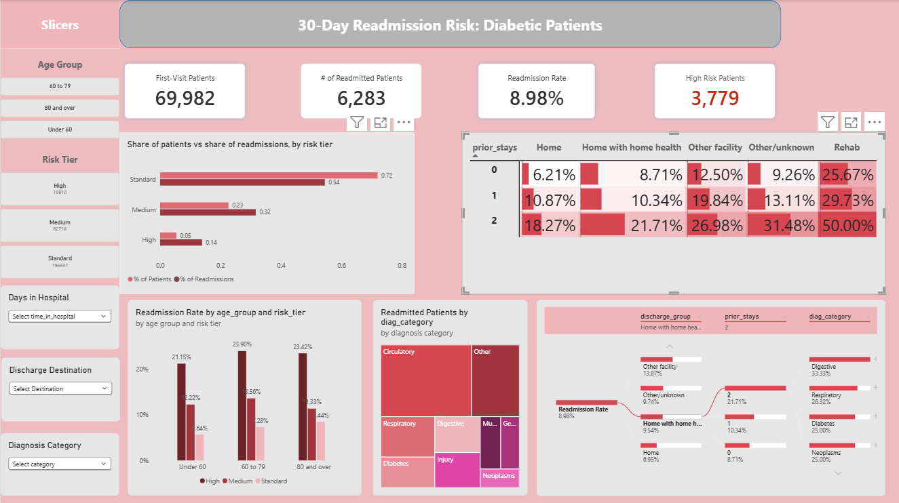
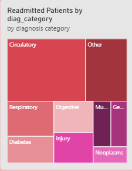
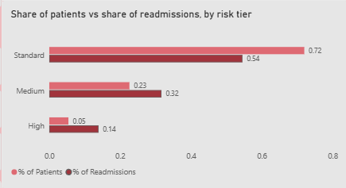
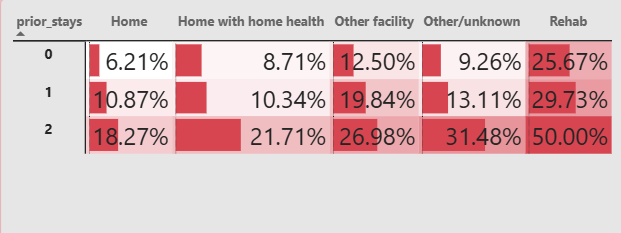
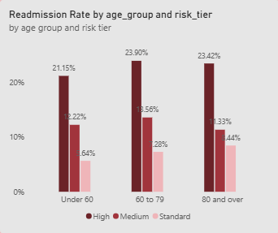

# Diabetic Patient 30-Day Readmission Analysis

## Overview

Hospitals can face financial penalties for some preventable readmissions, and follow-up care can help prevent many of them. This project analyzes encounters for 69,982 diabetic patients to find which factors are linked to returning within 30 days, and which patients a hospital should follow up with first.

**Business question:** Which diabetic patient and hospital-encounter factors are linked to 30-day readmission, and which patients should a hospital prioritize for follow-up to prevent avoidable readmissions?

## Key Findings
- About 9% of patients (8.98%) are readmitted within 30 days.
- Prior inpatient stays and discharge destination are the strongest factors. Readmission rises from 8.1% with no prior stays to 26.4% with 3 or more, and from 6.9% for patients sent home to 26.4% for patients sent to rehab.
- Age, length of stay, diagnosis and diabetes medication add smaller differences (about 2 to 5 points).
- Admission type, admission source, gender and number of procedures show little relationship.
- Risk factors stack. A patient sent home with 2 or more prior stays (18.3%) is riskier than a patient sent to another facility with none (12.5%).
- Simple risk tiers rank patients usefully: 23.1% readmission in the High tier versus 6.8% in the Standard tier. The High tier is 5.4% of patients but only 13.9% of readmissions, and 54.5% of readmissions still occur in the Standard tier, so tiers decide how much follow-up a patient gets, not whether they get any.
- Both main factors and the tiers hold within every age group, so they are not just a stand-in for age.
- Circulatory patients produce the most readmissions (33%) because of their volume, not their rate. Injury has the highest rate but far fewer patients.
- For patients admitted mainly for diabetes, those with an A1C test were readmitted less (7.23% versus 10.17%). This is an association, not proof that testing prevents readmission.

## Dataset

- **Source:** Diabetes 130-US Hospitals dataset (encounters from 130 US hospitals, 1999 to 2008)
- **Raw file:** 101,766 rows (one per hospital visit) and 50 columns, covering 71,518 unique patients
- **After cleaning:** 69,982 patients (each patient's first visit) and 50 columns
- **Target:** `readmitted_30d` (1 if the patient returned within 30 days, 0 otherwise)
- **Tools:** Python (pandas) in Jupyter Notebook, one notebook per question; Power BI for the dashboard; GitHub

## Data Cleaning

Full notebook: [diabetic_healthcare_cleaned.ipynb](notebooks/diabetic_healthcare_cleaned.ipynb)

**What the raw data looked like**

- 13 columns are numbers and 37 are text. Three columns hold numeric codes (`admission_type_id`, `discharge_disposition_id`, `admission_source_id`), which are translated with `IDS_mapping.csv`.
- Missing values: weight 96.9%, max_glu_serum 94.7%, A1Cresult 83.3%, medical_specialty 49.1%, payer_code 39.6%, race 2.2%, diag_3 1.4%, diag_2 0.4%, diag_1 21 rows.
- The original `readmitted` column has three values: NO (54,864), >30 (35,545) and <30 (11,357), a raw 30-day rate of 11.16%.
- Some count columns have extreme values with a median of 0 (prior inpatient stays up to 21, ER visits up to 76, outpatient visits up to 42). These are grouped as "3 or more" or "2 or more" in the analysis so a few extreme patients do not distort results.

**Cleaning steps**

| Step | Result | Why |
|---|---|---|
| Dropped `weight` and `payer_code` | 50 to 48 columns | Missing for 96.9% and 39.6% of patients |
| Labeled blanks instead of removing rows | No rows lost | A blank `A1Cresult` or `max_glu_serum` means the test was not ordered ("Not Tested"). Blank `medical_specialty` became "Not Specified", `race` "Unknown", `diag_2` and `diag_3` "None". Dropping these rows would have removed most of the data |
| Removed patients with no primary diagnosis | 101,766 to 101,745 rows | 21 patients; no blanks remained |
| Removed patients who died or went to hospice (discharge codes 11, 13, 14, 19, 20, 21) | 101,745 to 99,323 rows | 2,422 patients who cannot be readmitted |
| Kept only each patient's first visit | 99,323 to 69,982 rows | Removed 29,341 repeat visits so no patient is counted twice |
| Created `readmitted_30d` | 6,283 of 69,982 readmitted (8.98%) | The target for every question below |
| Grouped `diag_1` into 9 categories | 694 ICD-9 codes to 9 groups | Used the grouping from the original study. Circulatory is the largest group (21,392 patients) |

The 48 remaining columns plus `readmitted_30d` and the diagnosis category make the final 50.

**Why it matters:** keeping only first visits and removing patients who died lowers the rate from 11.16% to 8.98%, so every number below describes a patient's first visit in this data.

## Q1. Are prior hospital visits linked to readmission?

Notebook: [01_prior_visits.ipynb](notebooks/01_Prior_Visits.ipynb)

**Answer: yes, prior inpatient stays are the strongest single warning sign.**

| Prior visits in the past year | Readmission rate | Patients |
|---|---|---|
| **Inpatient stays: 0** | 8.13% | 61,786 |
| Inpatient stays: 1 | 12.88% | 5,800 |
| Inpatient stays: 2 | 18.52% | 1,501 |
| **Inpatient stays: 3 or more** | **26.37%** | 895 |
| ER visits: 0 | 8.74% | 64,882 |
| ER visits: 1 | 11.23% | 3,882 |
| ER visits: 2 or more | 14.45% | 1,218 |
| Outpatient visits: 0 | 8.80% | 60,860 |
| Outpatient visits: 1 | 10.36% | 4,780 |
| Outpatient visits: 2 or more | 10.00% | 4,342 |

- Patients with 3 or more prior inpatient stays are readmitted at over 3 times the rate of patients with none.
- Prior ER visits raise risk less, and prior outpatient visits matter least.

**What this tells us:** risk builds with each overnight stay, adding about 5 points for the first, 6 for the second and 8 for the third. A patient who has been admitted 2 or more times in the past year is a warning sign even if the current stay looks routine. Action: record the number of prior stays at discharge. It is a field the hospital already has.

## Q2. Does the length and complexity of the stay matter?

Notebook: [02_hospital_dtay.ipynb](notebooks/02_hospital_dtay.ipynb)

**Answer: somewhat. Longer, more complex stays point to sicker patients, but the gaps are smaller than for prior stays.**

| Days in hospital | Readmission rate | Patients |
|---|---|---|
| 1 to 2 days | 7.16% | 22,651 |
| 3 to 4 days | 8.48% | 21,910 |
| 5 to 7 days | 10.55% | 15,653 |
| 8 to 14 days | 11.79% | 9,768 |

- Number of diagnoses (6.19% to 10.05%), medications (7.30% to 10.46%) and lab tests (7.63% to 10.23%) show the same upward pattern.
- Number of procedures shows no clear pattern (8.73%, 9.62%, 8.83%, 8.98%).

**What this tells us:** a stay of 8 to 14 days carries 1.6 times the risk of a 1 to 2 day stay (11.79% versus 7.16%), but the spread is only about 4.6 points, far less than prior stays or discharge destination. Action: use a long stay as a secondary flag or tiebreaker, not as the main screening rule. More procedures do not mean more risk.

## Q3. Does where the patient goes after discharge matter?

Notebook: [03_admission_discharge.ipynb](notebooks/03_admission_discharge.ipynb)

**Answer: yes, this shows the biggest differences in the project. Patients sent to rehab are readmitted nearly 4 times as often as patients sent home.**

| Discharge destination (named groups of 400+ patients) | Readmission rate | Patients |
|---|---|---|
| Rehab facility | 26.36% | 1,411 |
| Other inpatient institution | 20.59% | 913 |
| Another short-term hospital | 13.70% | 1,540 |
| Skilled nursing facility | 13.42% | 8,788 |
| Intermediate care facility | 10.33% | 542 |
| Left against medical advice | 9.56% | 408 |
| Home with home health | 9.54% | 8,290 |
| Home | 6.95% | 44,320 |

Two 400+ groups with blank or unmapped codes in `IDS_mapping.csv` are left out (10.15% and 6.18%). How the patient arrived tells us little: admission type (Emergency 9.18%, Urgent 8.97%, Elective 8.29%) and admission source (8.07% to 9.39%) are both flat. Where they go next tells us a lot.

**What this tells us:** where a patient goes after discharge matters more than anything about how they arrived. Rehab (26.36%) is nearly 4 times home (6.95%), and other facilities (hospitals, nursing and intermediate care, other institutions) range from about 10% to 21%. Patients sent to another facility depend on a smooth handoff. Action: for patients discharged to rehab or another facility, send the discharge summary and medication list to the receiving facility and book the follow-up before the patient leaves.

## Q4. Do age, gender and race matter?

Notebook: [04_Demographics.ipynb](notebooks/04_Demographics.ipynb)

**Answer: age adds a modest amount of risk. Gender and race do not meaningfully separate risk.**

| Group | Readmission rate | Patients |
|---|---|---|
| Age under 60 | 7.12% | 23,677 |
| Age 60 to 79 | 9.66% | 33,436 |
| Age 80 and over | 10.62% | 12,869 |
| Female | 9.04% | 37,237 |
| Male | 8.91% | 32,742 |
| Caucasian | 9.19% | 52,303 |
| African American | 8.67% | 12,624 |

- Age: from about 7% for ages 20 to 59 to 10.79% for ages 80 to 90.
- Gender is nearly identical.
- Race differences are small among large groups. Smaller race groups were too small to compare reliably.

**What this tells us:** age adds a modest amount (about 3.5 points from under 60 to 80 and over), while gender and race barely separate risk. Q9 shows age adds little once discharge and prior stays are known. Action: build screening on clinical factors (prior stays, discharge destination), not demographics, and check that follow-up reaches all groups equally.

## Q5. Does the primary diagnosis matter?

Notebook: [05_main_diagnosis.ipynb](notebooks/05_main_diagnosis.ipynb)

**Answer: a little. Diagnosis creates a spread of about 3.5 points, smaller than prior stays or discharge destination.**

- Highest rate: injury (10.80%), followed by circulatory (9.68%) and diabetes (9.12%).
- Lowest rate: respiratory (7.30%) and digestive (8.01%).
- Biggest source of readmissions: circulatory, with 2,070 of the 6,283 readmissions (33%), because it is also the largest group (31% of patients).
- Injury has the highest rate but only 507 readmissions, because the group is small.

**What this tells us:** diagnosis creates only a 3.5-point spread, but volume matters. Circulatory patients are 31% of the data and account for 2,070 of the 6,283 readmissions (33%), even though their rate (9.68%) is only slightly above average. Injury has the highest rate (10.80%) but far fewer patients. Action: a circulatory follow-up protocol would reach the most readmissions, while diagnosis should not decide who is prioritized.

## Q6. Do testing and diabetes medication matter?

Notebook: [06_diabetes_care.ipynb](notebooks/06_diabetes_care.ipynb)

**Answer: yes. Patients who need more diabetes treatment are higher risk, and A1C testing is linked to lower readmission for patients admitted mainly for diabetes.**

| Diabetes care | Readmission rate | Patients |
|---|---|---|
| Not on diabetes medication | 7.56% | 16,684 |
| On diabetes medication | 9.42% | 53,298 |
| No medication change | 8.60% | 38,490 |
| Medication changed | 9.44% | 31,492 |
| No insulin | 8.29% | 34,264 |
| Insulin, steady dose | 9.26% | 21,619 |
| Insulin, dose up | 9.84% | 6,776 |
| Insulin, dose down | 10.54% | 7,323 |
| A1C tested (all patients) | 8.39% | 12,843 |
| A1C not tested (all patients) | 9.11% | 57,139 |
| **A1C tested (admitted mainly for diabetes)** | **7.23%** | 2,061 |
| **A1C not tested (admitted mainly for diabetes)** | **10.17%** | 3,687 |

- A1C testing is linked to lower readmission overall (8.39% versus 9.11%). For patients admitted mainly for diabetes the gap is much larger (7.23% versus 10.17%), though the pattern is mixed across other diagnoses.

**What this tells us:** patients whose diabetes needs more treatment are readmitted more often, and an insulin dose change in either direction is a marker (dose down 10.54%, dose up 9.84%, no insulin 8.29%). Among the 5,748 patients admitted mainly for diabetes, 3,687 had no A1C test. If those patients had been readmitted at the tested rate (7.23% instead of 10.17%), about 108 readmissions (1.7% of the total) would have been avoided. This is an upper-bound illustration of an association, not a proven effect. Action: check A1C status for diabetes admissions, flag insulin dose changes for follow-up, and test the effect with a small trial.

## Q7. Which patients should be prioritized? (Risk Tiers)

Notebook: [07_prioritized_patients.ipynb](notebooks/07_prioritized_patients.ipynb)

Plain rules based on Q1 to Q6:

- **High:** discharged to rehab, or 2 or more prior inpatient stays
- **Medium:** 1 prior inpatient stay, or discharged to another facility
- **Standard:** everyone else

| Tier | Patients | Share of Patients | Readmission Rate | Share of All Readmissions |
|---|---|---|---|---|
| High | 3,779 | 5.4% | 23.07% | 13.9% |
| Medium | 15,830 | 22.6% | 12.56% | 31.6% |
| Standard | 50,373 | 72.0% | 6.80% | 54.5% |

**Answer: the High tier is readmitted at about 3.4 times the rate of the Standard tier, and about 1 in 4 High-tier patients returns.**

- High and Medium together are 28% of patients but hold 45.5% of all readmissions.
- More than half of readmissions still occur in the Standard tier because it is 72% of patients. Tiers focus effort but will not catch every readmission.

**What this tells us:** the tiers sort patients well (23.07% in High, 6.80% in Standard), but they cannot find most readmissions on their own because the Standard tier is so large. Action: use the tiers to decide how much follow-up each patient gets, not whether they get any.

## Q8. Do risk factors stack?

Notebook: [08_stacked.ipynb](notebooks/08_stacked.ipynb)

**Answer: yes. Within every discharge group, more prior stays means higher readmission.**

| Discharge | 0 Stays | 1 Stay | 2+ Stays |
|---|---|---|---|
| Home | 6.2% | 10.9% | 18.3% |
| Home with home health | 8.7% | 10.3% | 21.7% |
| Other facility | 12.5% | 19.8% | 27.0% |
| Rehab | 25.7% | n/a | n/a |

Groups with fewer than 100 patients are not shown.

- For patients sent home, the rate roughly triples from 6.2% to 18.3%.
- A patient sent home with 2 or more prior stays (18.3%) is at higher risk than a patient sent to another facility with no prior stays (12.5%).
- Rehab patients are at 25.7% even with no prior stays.
- The lowest-risk group (home, no prior stays, 6.2%) and the highest reliable group (other facility, 2 or more stays, 27.0%) differ by more than 4 times.

**What this tells us:** the two factors add up. Home is the safest destination, yet a patient sent home with 2 or more prior stays (18.3%) is riskier than a patient sent to another facility with none (12.5%). Rehab patients are high risk even with no prior stays (25.7%). Action: do not look at discharge destination alone. A patient who is going home but has repeated admissions still needs follow-up.

## Q9. Do the findings hold within age groups?

Notebook: [09_all_age_groups.ipynb](notebooks/09_all_age_groups.ipynb)

Older patients are readmitted more often and are more likely to go to facilities, so discharge destination and prior stays were checked within three age groups (under 60, 60 to 79, 80 and over). Every group had at least 229 patients.

**Answer: yes, they hold. The two main factors are not just a stand-in for age.**

- Rehab discharges were readmitted at 25.8% (under 60), 28.2% (60 to 79) and 23.1% (80 and over), compared with 6.0%, 7.5% and 8.2% for patients sent home.
- Prior stays show the same pattern in every age group: the rate rose from 6.3% (0 stays) to 19.7% (2 or more) for patients under 60, and from 9.7% to 24.4% for patients 80 and over.
- A patient under 60 with 2 or more prior stays (19.7%) is at about twice the risk of an 80-year-old with none (9.7%). Age adds only a small amount on top, so the tiers are built on discharge destination and prior stays.
- The risk tiers also hold in every age group. High-tier patients were readmitted at 21.2% (under 60), 23.9% (60 to 79) and 23.4% (80 and over), compared with 5.6%, 7.3% and 8.4% for Standard-tier patients.

**What this tells us:** the tiers rank patients the same way at every age, with High about 3 to 4 times Standard in each group. An age-based rule would miss that a patient under 60 sent to rehab (25.8%) is far riskier than an 80-year-old sent home (8.2%). Action: use the same two screening questions for every adult patient.

## Factor Ranking

*[Add the ranking result from the final notebook here: which factors separate the lowest and highest readmission groups the most, among groups of 400+ patients.]*

## Dashboard

The one-page Power BI dashboard (`dashboard/healthcare_readmission.pbix`) answers the question **"Which diabetic patients are most likely to return within 30 days, and who should be followed up with first?"**

- **KPI cards:** 69,982 first-visit patients, 6,283 readmitted, 8.98% readmission rate, and 3,779 High-risk patients.
- **Share of patients vs share of readmissions, by risk tier:** shows the High tier is 5% of patients but 14% of readmissions, and over half of readmissions still come from the Standard tier.
- **Prior stays by discharge destination (heatmap):** shows the two main factors stack.
- **Risk tier by age group:** shows the tiers hold in every age group.
- **Slicers:** age group, risk tier, discharge group, diagnosis, days in hospital and A1C testing filter every chart. A Reset button clears all filters.

## Recommendations

1. **Screen at discharge with two questions:** where is the patient going, and how many overnight stays have they had in the past year? Both are known at discharge, so no new data is needed.
2. **Start with the High tier** (rehab discharges or 2 or more prior inpatient stays). It is about 5% of patients and is readmitted at 23%, roughly 2.6 times the overall rate. Give this group the most intensive follow-up, such as a phone call within a few days of discharge and a scheduled appointment.
3. **Extend to the Medium tier if capacity allows.** High and Medium together are 28% of patients and hold 45.5% of all readmissions, so this is the practical target for a hospital that can reach about 1 in 4 patients.
4. **Do not expect the tiers to catch everything.** The High tier holds only 13.9% of readmissions, and over half occur in the Standard tier. Pair the tiers with a general discharge process for everyone.
5. **Test routine A1C testing for patients admitted mainly for diabetes.** Readmission was 7.23% with an A1C test versus 10.17% without. This is an association, so a small trial is needed to see whether testing actually reduces readmissions.
6. **Do not use admission type, admission source, gender or number of procedures as screening criteria.** They show little or no relationship with readmission.
7. **Pilot before rolling out.** This data is from 1999 to 2008, so check the tiers on current patients and compare readmission rates for patients who receive follow-up with those who do not.

## Limitations

- Tier rules were chosen after looking at this same data, so the rates may be slightly optimistic on new patients.
- The data shows association, not cause. Rehab discharge marks sicker patients; it does not cause readmission.
- The data covers 1999 to 2008 and may not reflect current practice.
- The results apply to diabetic patients' first hospital stays at 130 US hospitals, not to all hospital patients.
- Several groups (some races, rehab patients with prior stays) are too small to compare.

## Files

- `notebooks/`: the cleaning notebook (`diabetic_healthcare_cleaned`) and one notebook per question (01 to 09 answer Q1 to Q9)
- `datasets/`: raw data, `diabetic_clean.csv` (cleaned) and `diabetic_dashboard.csv` (cleaned plus risk tier, age group, prior stays, discharge group and A1C tested columns used by Power BI)
- `dashboard/`: Power BI file (`.pbix`)
- `images/`: dashboard screenshot and chart images used in this README
